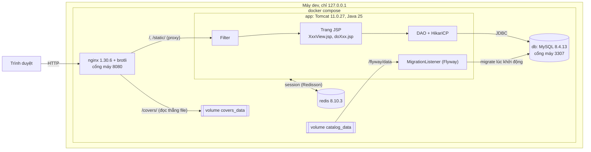
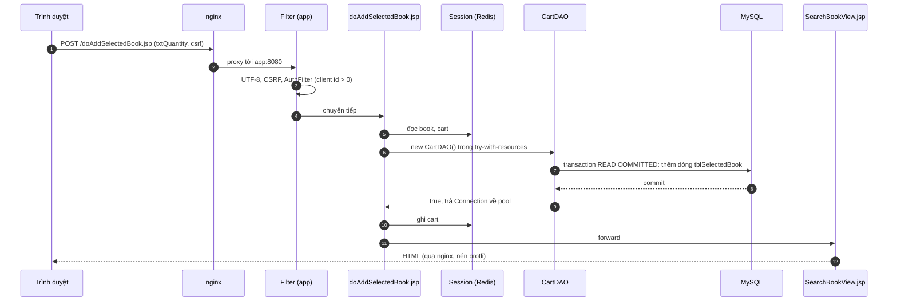
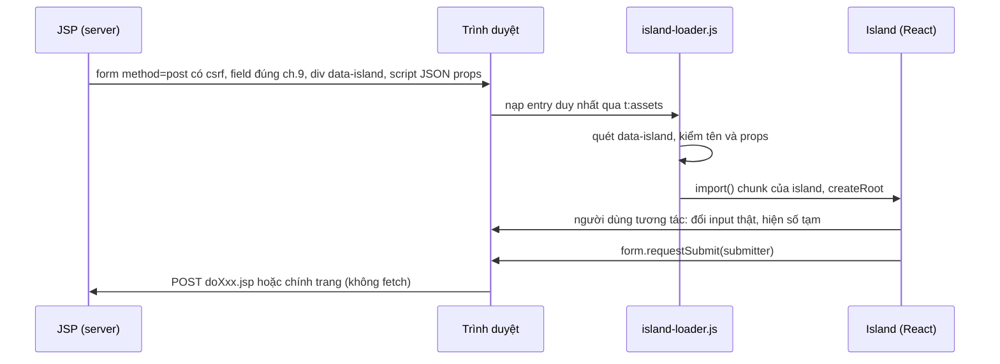

# Kiến trúc

<!-- updated 261111 -->

Trạng thái: sau phase 1 (khung, hạ tầng). Phase 8 cập nhật lại file này theo những gì đã làm. Hạ tầng chi tiết (cổng, volume, biến môi trường, build) là của `plans/261111-tiem-thue-truyen/contract.md` §3–§5, §10; nghiệp vụ là của [`docs/contracts.md`](contracts.md). File này giải thích các mảnh ghép với nhau thế nào.

## 1. Tổng thể



| Service | Vai trò | Có từ |
|---|---|---|
| `nginx` | Cổng vào duy nhất trên máy (`127.0.0.1:8080`); proxy tới `app:8080`; gzip và brotli; security header và CSP; phục vụ ảnh bìa từ `covers_data`, thiếu ảnh thì trả bìa giấy vẽ sẵn mã 200 | phase 1 |
| `app` | Tomcat 11.0.27 chạy `ROOT.war`; session ở Redis; không mở cổng ra máy | phase 1 |
| `db` | MySQL 8.4.13, `utf8mb4_0900_ai_ci`, giờ `+07:00`; volume `db_data` | phase 1 (schema từ phase 3) |
| `redis` | Session Tomcat và chặn đăng nhập sai; volume `redis_data` | phase 1 |

Dự án chỉ chạy localhost, không có prod ([ADR-0013](adr/0013-chi-chay-localhost.md)).

## 2. Kiến trúc JSP-DAO

Không có Servlet điều khiển, không Spring ([ADR-0001](adr/0001-jsp-dao-khong-controller.md)). Trang JSP là tầng điều khiển, đúng ch.9.

| Tầng | Ở đâu | Việc |
|---|---|---|
| Filter | `vn.tiemtruyen.filter` | UTF-8, đăng nhập và phân quyền (ma trận `docs/contracts.md` mục 12), CSRF cho mọi POST tới `*.jsp`, security header, chặn đăng nhập sai. Có từ phase 6; phase 1 chưa khai filter nào trong `web.xml` |
| Trang xem | `src/main/webapp/**/XxxView.jsp` | Đọc session, gọi DAO **đọc**, render HTML; tự gửi về chính nó khi tìm, đăng nhập, sửa bản sao trong session |
| Trang xử lí | `src/main/webapp/**/doXxx.jsp` | Không giao diện; đọc form và session, gán vào model, gọi DAO **ghi**, đặt thông báo rồi forward |
| Tag file | `WEB-INF/tags/`, `WEB-INF/tags/ui/` | `<t:assets/>` (nạp CSS/JS từ manifest Vite), `<t:csrf/>`, component giao diện (phase 5) |
| Model | `vn.tiemtruyen.model` | 13 lớp thực thể, `Serializable`, không thuộc tính dẫn xuất |
| DAO | `vn.tiemtruyen.dao` | Lớp cha `DAO` giữ `Connection` mượn từ HikariCP, `AutoCloseable`; 8 DAO, chữ kí đúng `docs/contracts.md` mục 5.3 |
| Util | `vn.tiemtruyen.util` | `AppConfig`, `Db` (DataSource), `ViteManifest`, `AssetTags`, `JsonReader`, `DbShutdownListener` (đã có); `Messages`, `Passwords`, `Codes`, `JsonUtil`, `MigrationListener` (phase 3) |

Luật cứng (bản đủ ở `docs/contracts.md` mục 5, 8 và `AGENTS.md` mục 10): không getById; không DAO cho SelectedBook, RentedBook, RentedDamage, RentalCollateral; mỗi đối tượng gốc một hàm cập nhật; mọi ghi DB qua `doXxx.jsp`; chỉ `PreparedStatement`.

## 3. Một request đi qua hệ thống

Ví dụ khách bấm "Thêm vào truyện đã chọn" ở BookDetailView (sau phase 6):



- POST thiếu hoặc sai token CSRF bị chặn 403 trước khi tới trang.
- Lỗi SQL không lường trước được ném ra, trang lỗi chung xử lí; hàm DAO không nuốt lỗi.
- Thông báo đi qua request attribute `message` khi forward (C2).

## 4. React island (cách B)

[ADR-0004](adr/0004-island-cach-b.md). Form do JSP render giữ việc gửi; island giữ tương tác.



- Bốn island: `SelectedStack` (SearchBookView), `ProcessBillDesk` (ProcessRentalBillView), `CollateralDrawer` (AddRentalCollateralView), `ShelfScene` (HomeView). Props, input được đổi: `docs/contracts.md` mục 11.
- Không có JS thì bảng, ô tích, nút HTML do JSP render vẫn gửi được.
- Build: Vite `root = frontend/`, `base = /static/`, ra `src/main/webapp/static/` (bị ignore); manifest ở `/static/.vite/manifest.json`, `util/ViteManifest` đọc một lần rồi cache trong `ServletContext`. `APP_VITE_DEV=true` thì `<t:assets/>` in `@vite/client` và preamble React refresh từ `APP_VITE_DEV_ORIGIN` (Vite dev server cổng 5173).

## 5. Session trong Redis

[ADR-0006](adr/0006-session-redis-redisson.md). `RedissonSessionManager` khai trong `conf/context.xml` của ảnh app (không trong WAR): `readMode="REDIS"`, `updateMode="DEFAULT"`, `keyPrefix="tiemtruyen:"`; cookie `HttpOnly`, `SameSite=Lax`, hết hạn sau 60 phút (`web.xml`).

- Mỗi thuộc tính session được tuần tự hoá riêng, nên hai thuộc tính không chia sẻ đối tượng (`docs/contracts.md` mục 7).
- Session sống qua lần khởi động lại `app`; Redis chết thì trang dùng session trả 500.
- Số quyển trống luôn đọc từ MySQL, không lấy từ session hay cache.

## 6. Dữ liệu và migration

[ADR-0008](adr/0008-flyway-qua-listener.md). Flyway chạy trong app lúc khởi động, hai location:

| Location | Nội dung | Có từ |
|---|---|---|
| `classpath:db/migration` | `V1__schema.sql` (13 bảng, [`docs/schema.md`](schema.md)), `V2__catalog_seed.sql` (loại lỗi, loại tài sản cọc, tài khoản mẫu [`docs/dev-accounts.md`](dev-accounts.md)) | phase 3 |
| `filesystem:/flyway/data` (volume `catalog_data`, mặc định) | `V10__catalog_data.sql`, `V11__sample_bills.sql` do pipeline sinh, ngoài git | phase 4 |
| `classpath:db/e2e` (khi `FLYWAY_DATA_LOCATION` đặt cho E2E) | `V10__e2e_catalog.sql`, dựng y hệt ch.2 (D3) | phase 3 |

Ảnh bìa: pipeline ghi `covers_data:/{bookId}/cover-{160|320|640}.{webp|avif}`; trang dùng URL `${APP_COVERS_BASE_URL}/{bookId}/cover-{w}.webp` (D2). Pipeline: [`docs/data-pipeline.md`](data-pipeline.md).

## 7. Cây thư mục

SSOT: `plans/261111-tiem-thue-truyen/contract.md` §2. Cột phải ghi trạng thái sau phase 1.

```
/
├─ AGENTS.md  CLAUDE.md  README.md
├─ pom.xml  mvnw  mvnw.cmd  .mvn/wrapper/
├─ compose.yaml  compose.e2e.yaml
├─ .env.example  .gitignore  .gitattributes  .editorconfig
├─ config/checkstyle/checkstyle.xml
├─ src/main/java/vn/tiemtruyen/{dao,model,filter,util}/
├─ src/main/resources/db/migration/        V1__schema.sql, V2__catalog_seed.sql
├─ src/main/resources/db/e2e/              V10__e2e_catalog.sql (chỉ lần chạy E2E)
├─ src/main/webapp/                        trang M1, M2, doCancelRentalBill.jsp, health.jsp
├─ src/main/webapp/nhan-vien/              trang M3, LoginView.jsp của nhân viên (D5)
├─ src/main/webapp/nhan-vien/quan-tri/     trang quản trị D6
├─ src/main/webapp/dev/                    StyleGuideView.jsp, HomePreviewView.jsp, session-probe.jsp
├─ src/main/webapp/WEB-INF/{web.xml, tags/, tags/ui/}
├─ src/main/webapp/static/                 đầu ra Vite (bị ignore)
├─ src/test/java/vn/tiemtruyen/{dao,util,filter,arch,schema}/
├─ frontend/{package.json, vite.config.ts, tsconfig.json, tsconfig.app.json, eslint.config.js, components.json}
├─ frontend/src/{loader,islands,components/ui,components/nostalgia,hooks,styles,three,lib}/
├─ frontend/public/img/                    hình trang trí tự vẽ, ảnh tĩnh của kệ, bìa dự phòng
├─ pipeline/{package.json, cli.mjs, manifest.jsonl}
├─ pipeline/{src/fetch,src/sources,src/steps,src/lib,config,schema,test}/
├─ data/                                   bị ignore: cache, raw, clean, images, export, reports
├─ docker/{app,nginx,mysql,redis}/
├─ e2e/{package.json, playwright.config.ts, tests/, fixtures/, lighthouse/}
├─ scripts/{accept,check,dev,smoke}/
├─ docs/  docs/adr/
├─ .github/workflows/
├─ .claude/rules/tiem-*.md  .claude/skills/tiem-*/  .claude/agents/tiem-*.md
├─ images/  prompt-web-tiem-thue-truyen.md  B23DCCN600 - Nguyen Duy Nghia - Bao cao tong hop.pdf   (chỉ đọc)
└─ plans/  plans/reports/
```

| Phần | Đã có sau phase 1 | Phase tạo phần còn lại |
|---|---|---|
| Gốc | `AGENTS.md`, `CLAUDE.md` (phase 2), `pom.xml`, `mvnw*`, `.mvn/wrapper/`, `compose.yaml`, `.env.example`, `.gitignore`, `.gitattributes`, `.editorconfig`, `config/checkstyle/` | `compose.e2e.yaml` (6), `README.md` (8) |
| Java | `util/{AppConfig, AssetTags, Db, DbShutdownListener, JsonReader, ViteManifest}`; test `util/` | `dao`, `model`, `Messages`, `Passwords`, `Codes`, `JsonUtil`, `MigrationListener` (3); `filter` (6) |
| Migration | | `db/migration`, `db/e2e` (3) |
| Webapp | `HomeView.jsp` tạm, `health.jsp`, `dev/session-probe.jsp`, `WEB-INF/web.xml`, `WEB-INF/tags/assets.tag` | `tags/ui/`, trang dev (5); trang M1, M2 (6); M3, D6 (7) |
| Frontend | `package.json`, `vite.config.ts`, `tsconfig.json`, `tsconfig.app.json`, `tsconfig.node.json`, `eslint.config.js`, `components.json`, `src/loader/`, `src/styles/app.css`, `src/lib/utils.ts`, `public/img/{cover-fallback.svg, favicon.svg}` | `islands`, `components`, `hooks`, `three`, token (5) |
| Docker | `docker/app/` (Dockerfile, `context.xml`, `redisson.yaml`), `docker/nginx/` (Dockerfile, `nginx.conf`, `conf.d/`, `snippets/`), `docker/mysql/conf.d/utf8mb4.cnf`, `docker/redis/redis.conf` | |
| Script | `scripts/accept/{_lib.mjs, phase-01.mjs, phase-02.mjs}`, `scripts/check/*`, `scripts/dev/{make-env.mjs, mvnw.mjs}` | `scripts/smoke/` (6, 7) |
| Khác | | `pipeline/` (4), `e2e/`, `.github/workflows/` (8) |

Lệch so với cây chuẩn, đã ghi ở phase 1: có thêm `frontend/tsconfig.node.json`, `scripts/dev/mvnw.mjs`, `scripts/accept/_lib.mjs`, `util/JsonReader` (đọc manifest khi chưa có Jackson, phase 3 thay), `util/DbShutdownListener`. Ảnh `db` và `redis` dùng ảnh chính thức, thư mục `docker/mysql/`, `docker/redis/` chỉ chứa file cấu hình.

## 8. Bảo mật tối thiểu

- Mọi cổng chỉ mở trên `127.0.0.1`; `app` và `redis` không mở cổng ra máy.
- CSP phase 1: `default-src 'self'`, `script-src 'self'`, `font-src 'self'`, `frame-ancestors 'none'`… (`contract.md` §10); font tự host nên không cần nới ([ADR-0011](adr/0011-font-tu-host.md)).
- Mật khẩu băm Argon2id ([ADR-0007](adr/0007-password4j-argon2id.md)); bí mật chỉ nằm trong `.env` (bị ignore); `AppConfig` thiếu `APP_DB_PASSWORD` hoặc `REDIS_PASSWORD` thì ném lỗi nêu tên biến.
- Ảnh app chạy bằng user không phải root; jar Redisson và Maven kiểm checksum lúc build.
