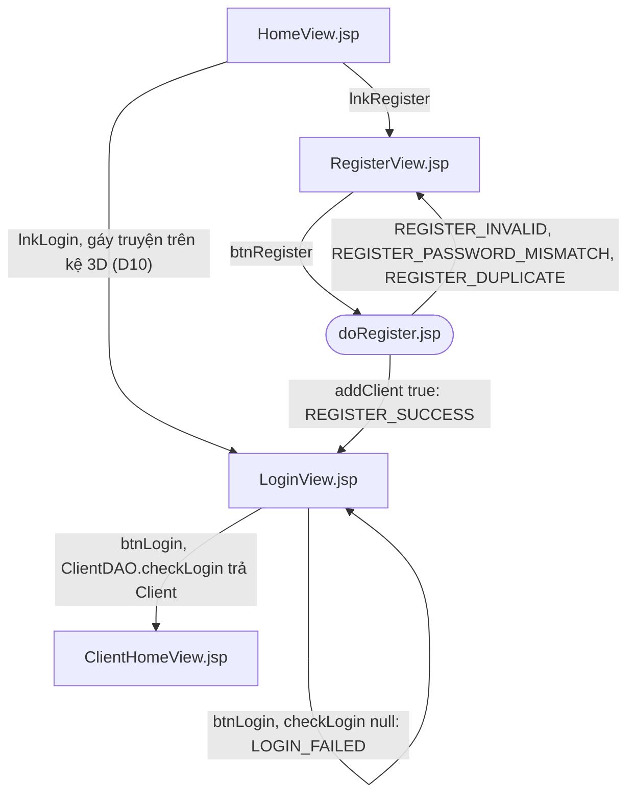
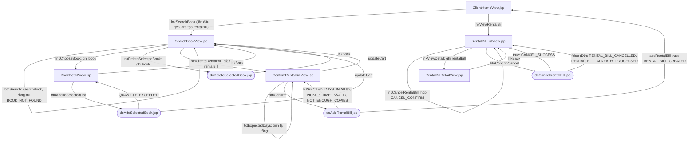
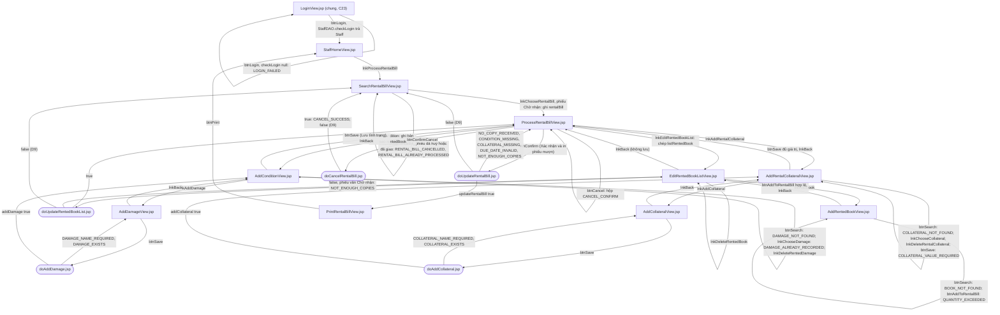
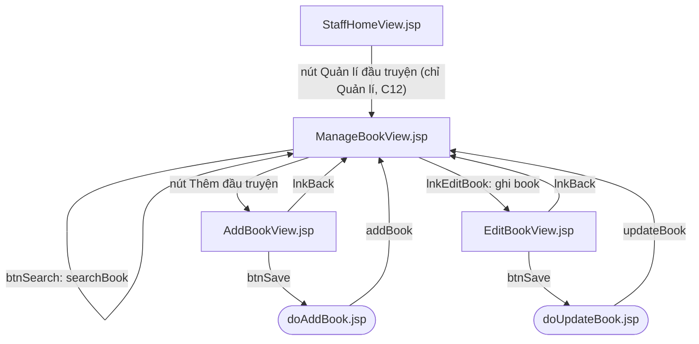

# Luồng trang

<!-- updated 261111 -->

Luồng giữa các trang JSP của ba chức năng, theo ch.9 và ch.10. Tên trang, field, thuộc tính session và thông báo là của [`docs/contracts.md`](contracts.md) mục 9 (chi tiết từng trang) và mục 10 (tên hằng thông báo); sơ đồ chỉ tóm tắt đường đi, không thay hợp đồng. Hai file lệch nhau thì `contracts.md` thắng.

Module theo tên ảnh màn hình `images/svg/ui_m*_*.svg`: **M1** đăng kí, **M2** tìm và chọn truyện trực tuyến, **M3** nhận truyện tại quầy.

Kí hiệu:

- Hình chữ nhật: trang xem `XxxView.jsp`. Hình viên thuốc: trang xử lí `doXxx.jsp` (không giao diện, mọi lần ghi DB).
- Nhãn cạnh là field được bấm (`lnk…`, `btn…`) hoặc kết quả; chữ in hoa là hằng thông báo của `Messages`.
- Vòng về chính trang: trang gửi về chính nó (tìm, đăng nhập, sửa bản sao trong session).
- Đường dẫn: trang M1, M2 ở gốc web; trang M3 ở `/nhan-vien/`; `doCancelRentalBill.jsp` một file ở gốc, khách và nhân viên dùng chung (Deferred #13).

## M1. Khách hàng đăng kí

- doRegister ghi `client` (không có mật khẩu, `id = 0`) để RegisterView điền lại khi lỗi; thành công thì bỏ `client` (C5).
- Đăng nhập sai nhiều lần bị chặn vẫn báo `LOGIN_FAILED` (Deferred #23).

## M2. Khách hàng tìm và chọn truyện muốn thuê trực tuyến

- Session chỉ giữ `cart` và `rentalBill` trong lúc khách đang chọn; doAddRentalBill bỏ cả hai khi thành công.
- Nút "Huỷ phiếu" chỉ có ở phiếu "Chờ nhận"; quay lại RentalBillListView từ trang con thì hiện `listRentalBill` trong session, không đọc lại DB.

## M3. Khách hàng đến nhận truyện tại quầy

- doUpdateRentalBill kiểm bốn điều kiện theo đúng thứ tự `docs/contracts.md` mục 10.2.
- Ba trang gọi `updateRentalBill` (doCancelRentalBill, doUpdateRentedBookList, doUpdateRentalBill) đều chặn D9: phiếu đã đổi trạng thái thì báo theo trạng thái mới và về SearchRentalBillView (`docs/contracts.md` mục 6.3).
- ProcessRentalBillView bỏ `listRentedBook`, `listRentalCollateral`, `rentedBook` mỗi lần hiển thị (C6).

## Trang quản trị D6 (ngoài báo cáo)

Chỉ nhân viên có `position = "Quản lí"`, ở `/nhan-vien/quan-tri/`. Tên trang và hàm DAO đã chốt; thành phần, field và lối vào là đề xuất C12, chốt trước phase 7.

