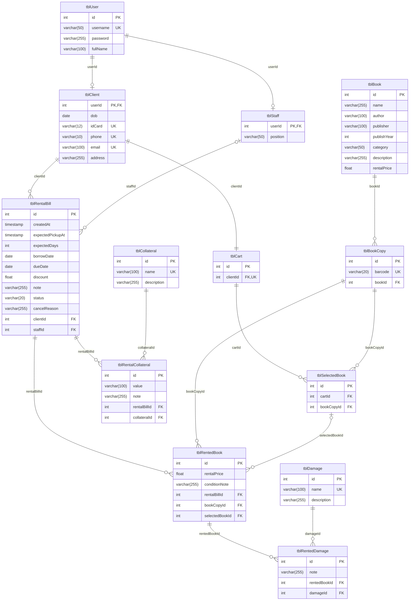

# Schema MySQL và ERD

<!-- updated 261111 -->

13 bảng của ch.8 (tr.53–55) và ERD `images/svg/design_database.svg`, khác báo cáo duy nhất ở `tblUser.password varchar(255)` (D1, [ADR-0002](adr/0002-password-varchar-255.md)).

- **SSOT là [`docs/contracts.md`](contracts.md) mục 2.** Bảng cột ở mục 3 dưới đây là bản chép **có chủ đích** để `SchemaConformanceTest` (phase 3) đọc máy. Chép bằng script, không gõ tay; hai file lệch nhau thì `contracts.md` thắng và file này phải chép lại.
- Ý nghĩa nghiệp vụ của từng cột, giá trị hằng và luật "không cột dẫn xuất": `docs/contracts.md` mục 1–4.
- Migration: `src/main/resources/db/migration/V1__schema.sql` (phase 3), chạy bằng Flyway lúc app khởi động ([ADR-0008](adr/0008-flyway-qua-listener.md)).

## 1. ERD

Thứ tự trong khối thuộc tính: kiểu, tên cột, khoá (`PK`, `FK`, `UK` = UNIQUE).

## 2. Quy ước đọc bảng

| Cột | Giá trị được dùng |
|---|---|
| Kiểu | Cú pháp MySQL: `int`, `varchar(n)`, `date`, `timestamp`, `float` |
| Null | `NULL` hoặc `NOT NULL` |
| Khoá | Trống, `PK`, `UNIQUE`, `FK→tblY.cột`, hoặc `PK, FK→tblY.cột` |

Ràng buộc không nằm trong cột Khoá (ghi ở ghi chú dưới bảng của `docs/contracts.md` mục 2), test vẫn phải kiểm:

- `tblCart.clientId` UNIQUE (quan hệ 1-1 Client – Cart).
- Index: `tblBook(name)`, `tblBook(author)`, `tblRentalBill(status)`, `tblRentedBook(bookCopyId)`.
- Mặc định: `tblRentalBill.createdAt DEFAULT CURRENT_TIMESTAMP`, `tblRentalBill.discount DEFAULT 0`.
- `id` là `AUTO_INCREMENT`, trừ `tblClient`, `tblStaff` (khoá chính `userId`). InnoDB, `utf8mb4`, collation `utf8mb4_0900_ai_ci`.

Định dạng máy đọc: mỗi bảng một heading `### tblX`, một dòng trống, rồi bảng có header đúng `| Cột | Kiểu | Null | Khoá |`. Không chèn gì giữa heading và bảng.

## 3. Bảng cột

### tblUser

| Cột | Kiểu | Null | Khoá |
|---|---|---|---|
| id | int | NOT NULL | PK |
| username | varchar(50) | NOT NULL | UNIQUE |
| password | varchar(255) | NOT NULL | |
| fullName | varchar(100) | NOT NULL | |

### tblClient

| Cột | Kiểu | Null | Khoá |
|---|---|---|---|
| userId | int | NOT NULL | PK, FK→tblUser.id |
| dob | date | NOT NULL | |
| idCard | varchar(12) | NOT NULL | UNIQUE |
| phone | varchar(10) | NOT NULL | UNIQUE |
| email | varchar(100) | NOT NULL | UNIQUE |
| address | varchar(255) | NOT NULL | |

### tblStaff

| Cột | Kiểu | Null | Khoá |
|---|---|---|---|
| userId | int | NOT NULL | PK, FK→tblUser.id |
| position | varchar(50) | NOT NULL | |

### tblBook

| Cột | Kiểu | Null | Khoá |
|---|---|---|---|
| id | int | NOT NULL | PK |
| name | varchar(255) | NOT NULL | |
| author | varchar(100) | NOT NULL | |
| publisher | varchar(100) | NOT NULL | |
| publishYear | int | NULL | |
| category | varchar(50) | NOT NULL | |
| description | varchar(255) | NULL | |
| rentalPrice | float | NOT NULL | |

### tblBookCopy

| Cột | Kiểu | Null | Khoá |
|---|---|---|---|
| id | int | NOT NULL | PK |
| barcode | varchar(20) | NOT NULL | UNIQUE |
| bookId | int | NOT NULL | FK→tblBook.id |

### tblDamage

| Cột | Kiểu | Null | Khoá |
|---|---|---|---|
| id | int | NOT NULL | PK |
| name | varchar(100) | NOT NULL | UNIQUE |
| description | varchar(255) | NULL | |

### tblCollateral

| Cột | Kiểu | Null | Khoá |
|---|---|---|---|
| id | int | NOT NULL | PK |
| name | varchar(100) | NOT NULL | UNIQUE |
| description | varchar(255) | NULL | |

### tblCart

| Cột | Kiểu | Null | Khoá |
|---|---|---|---|
| id | int | NOT NULL | PK |
| clientId | int | NOT NULL | FK→tblClient.userId |

### tblSelectedBook

| Cột | Kiểu | Null | Khoá |
|---|---|---|---|
| id | int | NOT NULL | PK |
| cartId | int | NOT NULL | FK→tblCart.id |
| bookCopyId | int | NOT NULL | FK→tblBookCopy.id |

### tblRentalBill

| Cột | Kiểu | Null | Khoá |
|---|---|---|---|
| id | int | NOT NULL | PK |
| createdAt | timestamp | NOT NULL | |
| expectedPickupAt | timestamp | NOT NULL | |
| expectedDays | int | NOT NULL | |
| borrowDate | date | NULL | |
| dueDate | date | NULL | |
| discount | float | NOT NULL | |
| note | varchar(255) | NULL | |
| status | varchar(20) | NOT NULL | |
| cancelReason | varchar(255) | NULL | |
| clientId | int | NOT NULL | FK→tblClient.userId |
| staffId | int | NULL | FK→tblStaff.userId |

### tblRentedBook

| Cột | Kiểu | Null | Khoá |
|---|---|---|---|
| id | int | NOT NULL | PK |
| rentalPrice | float | NOT NULL | |
| conditionNote | varchar(255) | NULL | |
| rentalBillId | int | NOT NULL | FK→tblRentalBill.id |
| bookCopyId | int | NOT NULL | FK→tblBookCopy.id |
| selectedBookId | int | NULL | FK→tblSelectedBook.id |

### tblRentedDamage

| Cột | Kiểu | Null | Khoá |
|---|---|---|---|
| id | int | NOT NULL | PK |
| note | varchar(255) | NULL | |
| rentedBookId | int | NOT NULL | FK→tblRentedBook.id |
| damageId | int | NOT NULL | FK→tblDamage.id |

### tblRentalCollateral

| Cột | Kiểu | Null | Khoá |
|---|---|---|---|
| id | int | NOT NULL | PK |
| value | varchar(100) | NOT NULL | |
| note | varchar(255) | NULL | |
| rentalBillId | int | NOT NULL | FK→tblRentalBill.id |
| collateralId | int | NOT NULL | FK→tblCollateral.id |
